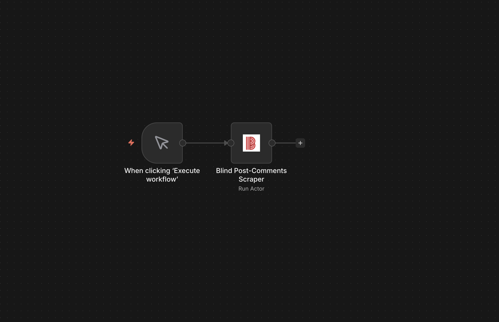
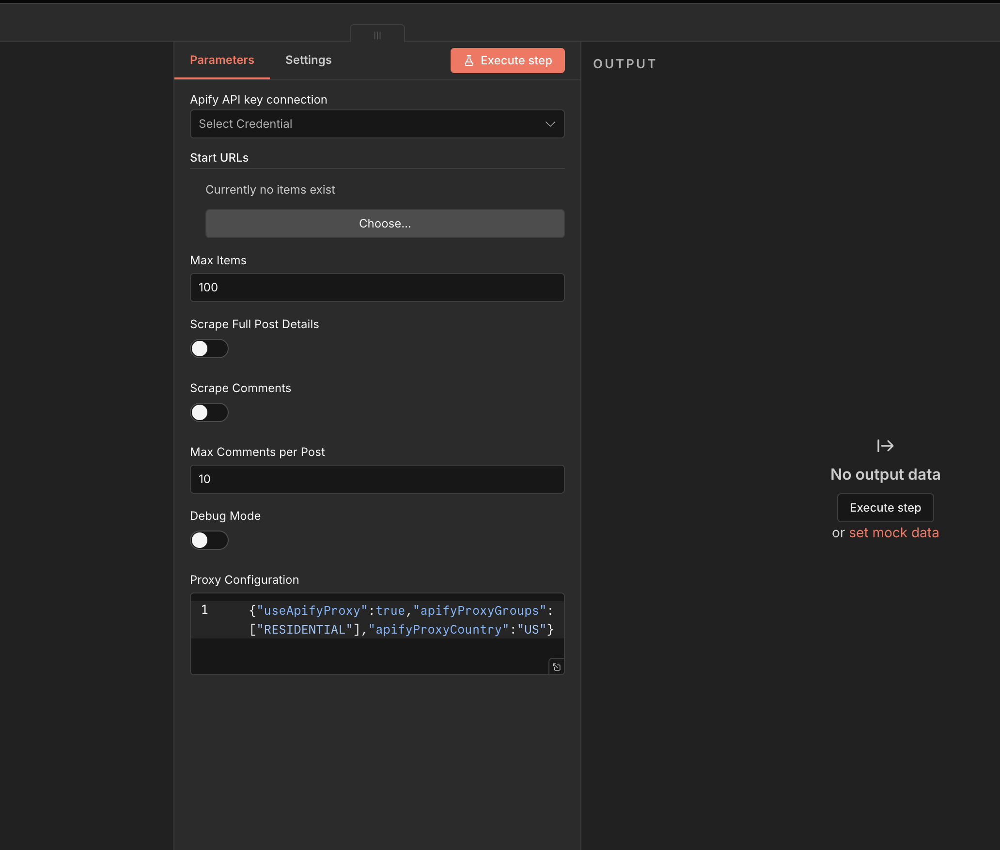

# n8n-nodes-hypebridge-actors

n8n community nodes for [Hypebridge](https://hypebridge.io) [Apify](https://apify.com) Actors — e-commerce catalog extraction, event & ticketing pipelines, running race monitors, influencer marketing intelligence, and B2B lead feeds.



## Table of Contents

- [Installation](#installation)
- [Workflow Recipes](#workflow-recipes)
- [Nodes Included (40 Public Actors)](#nodes-included-40-public-actors)
  - [E-Commerce & Retail](#e-commerce--retail)
  - [Events, Ticketing & Nightlife](#events-ticketing--nightlife)
  - [Running & Endurance Races](#running--endurance-races)
  - [Influencer Marketing & Creator Analytics](#influencer-marketing--creator-analytics)
  - [Music, Podcasts & Social](#music-podcasts--social)
  - [B2B Leads, Finance, Markets & Directories](#b2b-leads-finance-markets--directories)
- [Credentials](#credentials)
- [Usage](#usage)
- [Compatibility](#compatibility)
- [Support](#support)

## Installation

### n8n Cloud / Desktop

1. Go to **Settings → Community Nodes**
2. Click **Install a community node**
3. Enter `n8n-nodes-hypebridge-actors`
4. Click **Install**

### Self-hosted n8n

```bash
npm install n8n-nodes-hypebridge-actors
```

Then restart n8n.

## Workflow Recipes

### 1. Temu Product & Price Catalog Sync

```
Manual Trigger → Temu Scraper → Google Sheets
```

Start with one supported product, category, or home-feed URL and set **Max items** to `10`. Keep **Get product details** enabled when you need SKU options, specifications, images, or video; disable it for listing fields only. Leave **Extract customer reviews** off unless you need review ratings and dates (written review text is unavailable on Temu). Keyword search and merchant pages are not supported.

### 2. Automated Local Event Discovery Pipeline

```
Schedule Trigger → Find Events (or Eventbrite Search / Luma) → Filter → Google Sheets / Slack
```

Use **Find Events** to query Eventbrite, Meetup, Luma, Dice, Eventnoire, Posh, Prekindle, and Shotgun in one normalized schema, or target individual platforms such as **Eventbrite Search Scraper**, **Luma Event Scraper**, **Posh VIP Events**, or **Resident Advisor**.

### 3. Trail & Road Race Waitlist / Price-Tier Alerts

```
Schedule Trigger → UltraSignup Race Scraper (or RunSignup) → IF (delta only) → Slack / Email
```

Track spots remaining, waitlist counts, sold-out status, and upcoming price hikes across race distances so your workflow fires alerts only when availability or pricing changes.

### 4. Music Curator & Creator Outreach

```
Manual / Schedule Trigger → Spotify Play Counts & Curator Contacts (or Influencer Discovery Agent) → Filter → HubSpot / Google Sheets
```

Collect public playlist curator contacts, artist listener cities, or Instagram/TikTok creator fit scores and route qualified matches straight to your CRM.

> **Cost guardrail:** Test workflows manually with small limits (`10` records, `1–2` URLs) before turning on a schedule. Apify Actor runs are billed to your Apify account under each Actor's current pricing — set an Apify spending limit on recurring schedules (**Max items** is a record limit, not a dollar limit).

## Nodes Included (40 Public Actors)

Browse all Actors on the [Hypebridge Apify Store](https://apify.com/hypebridge).

### E-Commerce & Retail

| Node | Description | Apify Actor |
|------|-------------|-------------|
| **Temu** | Collect product prices, ratings, review counts, images, video, SKU options, specifications, and category taxonomy (product, category & home-feed URLs) | [hypebridge/temu-scraper](https://apify.com/hypebridge/temu-scraper) |
| **Amazon Product Scraper** | Scrape Amazon search results and product pages across 23 country storefronts | [hypebridge/amazon-product-scraper](https://apify.com/hypebridge/amazon-product-scraper) |
| **SHEIN Scraper** | Extract product listings and product detail data from SHEIN US (homepage, search, categories, product pages) | [hypebridge/shein-scraper](https://apify.com/hypebridge/shein-scraper) |
| **Shopify Shop.app Scraper** | Extract Shop.app products from category pages, keyword search results, and public deals | [hypebridge/shop-app-scraper](https://apify.com/hypebridge/shop-app-scraper) |
| **Fashion Nova Scraper** | Extract Fashion Nova product data from homepage, category, search, and product URLs | [hypebridge/fashionnova-scraper](https://apify.com/hypebridge/fashionnova-scraper) |
| **NFM Product Scraper** | Extract Nebraska Furniture Mart catalog listings with optional detail-page GTIN, brand, ratings & availability | [hypebridge/nfm](https://apify.com/hypebridge/nfm) |
| **US Grocery Price Comparator** | Compare Walmart vs Target grocery product pricing across the US | [hypebridge/us-grocery-price-comparator](https://apify.com/hypebridge/us-grocery-price-comparator) |

### Events, Ticketing & Nightlife

| Node | Description | Apify Actor |
|------|-------------|-------------|
| **Find Events** | Query Eventbrite, Meetup, Luma, Dice, Eventnoire, Posh, Prekindle & Shotgun in one normalized schema | [hypebridge/find-events](https://apify.com/hypebridge/find-events) |
| **Eventbrite Search Scraper** | Scrape Eventbrite search, discovery, and event detail pages | [hypebridge/eventbrite-search](https://apify.com/hypebridge/eventbrite-search) |
| **Luma Event Scraper** | Collect Luma events, calendars, host profiles, and optional full event details | [hypebridge/luma-com-event-scraper](https://apify.com/hypebridge/luma-com-event-scraper) |
| **Posh VIP Events** | Extract Posh VIP nightlife, concerts, tickets, pricing, venue, and organizer data | [hypebridge/posh-vip](https://apify.com/hypebridge/posh-vip) |
| **Resident Advisor Scraper** | Extract Resident Advisor (ra.co) events by city plus venues, promoters, artists, labels, and news | [hypebridge/resident-advisor-scraper](https://apify.com/hypebridge/resident-advisor-scraper) |
| **Fever Events Scraper** | Extract Fever events, sessions, ticket tiers, prices, availability, ratings, and optional reviews | [hypebridge/fever-events-scraper](https://apify.com/hypebridge/fever-events-scraper) |
| **Dice.fm** | Scrape Dice.fm concerts, festivals, DJ events, and live shows | [hypebridge/dice-fm](https://apify.com/hypebridge/dice-fm) |
| **Shotgun Live** | Scrape Shotgun.live electronic music, nightlife, and party events worldwide | [hypebridge/shotgun-live](https://apify.com/hypebridge/shotgun-live) |
| **Prekindle** | Scrape Prekindle event listings and venue information | [hypebridge/prekindle](https://apify.com/hypebridge/prekindle) |
| **Meetup Scraper (All URLs)** | Extract Meetup city browse, search, group profile, and event detail pages without an API key | [hypebridge/meetup-scraper-all-urls](https://apify.com/hypebridge/meetup-scraper-all-urls) |
| **Sympla Events & Tickets** | Collect Sympla and Sympla Bileto event discovery, ticketing, and reserved-seating data | [hypebridge/sympla-events-scraper](https://apify.com/hypebridge/sympla-events-scraper) |
| **Showpass Event Scraper** | Extract Showpass public event listings, ticket pricing, venues, and organizer profiles | [hypebridge/showpass-event-scraper](https://apify.com/hypebridge/showpass-event-scraper) |
| **Xceed Events Scraper** | Extract Xceed nightlife, club, and festival events with line-ups, venues, and ticket tiers | [hypebridge/xceed-events-scraper](https://apify.com/hypebridge/xceed-events-scraper) |
| **Partiful Events Scraper** | Scrape public Partiful explore feeds, event pages, and host profiles via direct HTTP | [hypebridge/partiful-events-scraper](https://apify.com/hypebridge/partiful-events-scraper) |
| **Eventeny Vendor & Market Directory** | Extract Eventeny events, vendor/exhibitor applications, booth fees, deadlines & ticket tiers | [hypebridge/eventeny-vendor-market-directory](https://apify.com/hypebridge/eventeny-vendor-market-directory) |
| **FilmFreeway Festival Scraper** | Extract film-festival listings, deadlines, entry fees, venues, ratings & qualification badges | [hypebridge/filmfreeway-festival-scraper](https://apify.com/hypebridge/filmfreeway-festival-scraper) |
| **Eventnoire** | Scrape Eventnoire Black culture events and listings | [hypebridge/eventnoire](https://apify.com/hypebridge/eventnoire) |

### Running & Endurance Races

| Node | Description | Apify Actor |
|------|-------------|-------------|
| **UltraSignup Race Scraper** | Track UltraSignup trail & ultramarathon races with spots remaining, waitlists, price tiers, and change alerts | [hypebridge/ultrasignup-race-scraper](https://apify.com/hypebridge/ultrasignup-race-scraper) |
| **RunSignup Race Scraper** | Extract RunSignup race listings, sub-events, registration fee ladders, price-change dates & sponsors | [hypebridge/runsignup-race-scraper](https://apify.com/hypebridge/runsignup-race-scraper) |

### Influencer Marketing & Creator Analytics

| Node | Description | Apify Actor |
|------|-------------|-------------|
| **Influencer Discovery Agent** | Discover and rank Instagram + TikTok influencers matching your brand criteria | [hypebridge/influencer-discovery-agent-instagram-tiktok](https://apify.com/hypebridge/influencer-discovery-agent-instagram-tiktok) |
| **Influencer Evaluation Agent** | Deep AI-powered influencer profile & audience evaluation (Instagram + TikTok) | [hypebridge/influencer-evaluation-agent-instagram-tiktok](https://apify.com/hypebridge/influencer-evaluation-agent-instagram-tiktok) |
| **Influencer Brand Fit Evaluator** | Assess Instagram/TikTok creator alignment criterion-by-criterion with fit scores | [hypebridge/hypebridge-brand-fit](https://apify.com/hypebridge/hypebridge-brand-fit) |
| **Influencer Pricing Calculator** | Price Instagram or TikTok creators with deliverable rate cards, add-ons & UGC market comps (USD) | [hypebridge/hypebridge-pricing](https://apify.com/hypebridge/hypebridge-pricing) |

### Music, Podcasts & Social

| Node | Description | Apify Actor |
|------|-------------|-------------|
| **Spotify Play Counts & Curators** | Extract Spotify play counts, artist listener cities, preview URLs & public playlist curator contacts | [hypebridge/spotify-play-count-curator-scraper](https://apify.com/hypebridge/spotify-play-count-curator-scraper) |
| **Podcast Transcript & Mentions** | Extract episode metadata, credits, transcripts & timestamped keyword mentions | [hypebridge/podcast-transcript-mention-extractor](https://apify.com/hypebridge/podcast-transcript-mention-extractor) |
| **Threads Reply Tree Scraper** | Scrape Threads posts with nested reply trees and profile posts via plain HTTP | [hypebridge/threads-scraper](https://apify.com/hypebridge/threads-scraper) |

### B2B Leads, Finance, Markets & Directories

| Node | Description | Apify Actor |
|------|-------------|-------------|
| **GoodFirms Agency Scraper** | Extract CRM-ready B2B agency leads, emails, phone numbers, hourly rates, team size & reviews | [hypebridge/goodfirms-agency-scraper](https://apify.com/hypebridge/goodfirms-agency-scraper) |
| **Economic Calendar API** | Collect normalized macroeconomic releases from Fed, BLS, BEA, FRED, ECB, Eurostat, ONS & BoE | [hypebridge/economic-calendar-api](https://apify.com/hypebridge/economic-calendar-api) |
| **Whop Campaign Intelligence** | Collect public Content Rewards campaigns, Whop catalog searches & company profiles | [hypebridge/whop-campaign-intelligence](https://apify.com/hypebridge/whop-campaign-intelligence) |
| **DraftKings Predictions** | Scrape DraftKings Predictions markets, odds & pricing across sports and financial categories | [hypebridge/draftkings-predictions](https://apify.com/hypebridge/draftkings-predictions) |
| **Eater** | Scrape restaurant guides, maps & city listings from Eater.com | [hypebridge/eater](https://apify.com/hypebridge/eater) |
| **Blind Post Scraper** | Scrape posts, comments & discussions from TeamBlind | [hypebridge/blind-post-scraper](https://apify.com/hypebridge/blind-post-scraper) |
| **Escort Alligator / ListCrawler** | Collect public listing cards and optional detail fields from city result pages | [hypebridge/escortalligator-listcrawler](https://apify.com/hypebridge/escortalligator-listcrawler) |

## Credentials

All nodes require an Apify account and API token:

1. Create an account or sign in at [apify.com](https://apify.com) (includes `$5/mo` free platform credits)
2. Go to **Settings → Integrations → API tokens**
3. Copy your API token
4. In n8n, create credentials for **Apify API** and paste your token

Two authentication methods are supported:
- **API Token** — Works everywhere (recommended)
- **OAuth2** — Available on n8n Cloud only

## Usage

### Basic Workflow

1. Add a trigger node (e.g., Manual Trigger, Schedule, Webhook)
2. Add any Hypebridge node
3. Configure your Apify credentials
4. Set input parameters (URLs, search queries, max items, etc.)
5. Execute the workflow



### As an AI Agent Tool

All nodes have `usableAsTool: true`, making them available as tools for n8n AI Agents:

1. Add an **AI Agent** node
2. Connect a Hypebridge node as a tool
3. The agent can invoke scrapers based on user prompts

## Compatibility

| n8n Version | Status |
|-------------|--------|
| 1.57.0+ | ✅ Tested |
| 1.40.0+ | ✅ Should work |

## Support

- **Apify Actors**: [apify.com/hypebridge](https://apify.com/hypebridge)
- **Issues**: [GitHub Issues](https://github.com/daredammy/n8n-nodes-hypebridge-actors/issues)
- **n8n Community**: [community.n8n.io](https://community.n8n.io/)

## License

MIT
